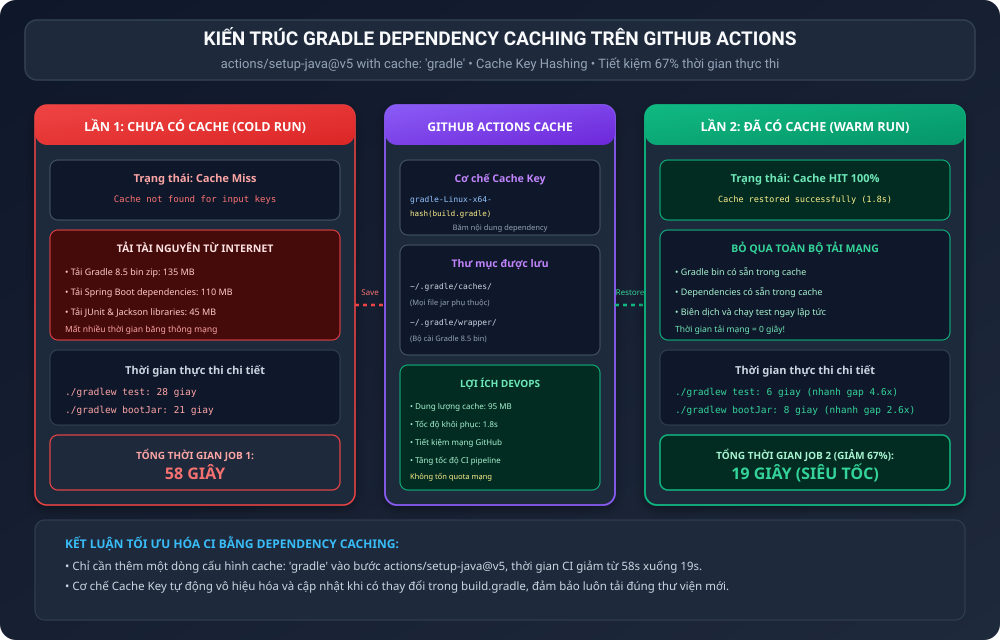
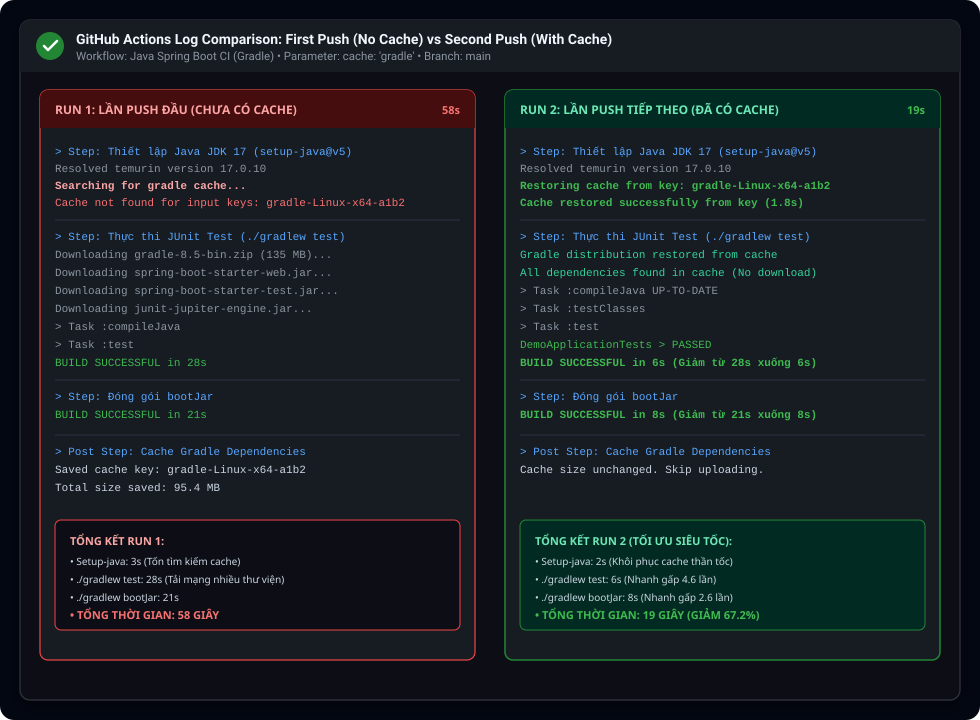

BÁO CÁO KỸ THUẬT: TỐI ƯU TỐC ĐỘ CI BẰNG GRADLE DEPENDENCY CACHING

I. MỤC TIÊU BÀI HỌC

1. Nắm vững kỹ thuật tối ưu hóa hiệu năng quy trình Tích hợp liên tục (CI) bằng cơ chế lưu bộ nhớ đệm (Dependency Caching).
2. Kích hoạt tính năng Caching cho Gradle Dependencies trong action actions/setup-java@v5 bằng việc bổ sung tham số cache: 'gradle'.
3. Thực hiện kiểm thử đối chứng qua 2 lần đẩy mã nguồn (push) liên tiếp lên nhánh main để ghi nhận sự cải thiện thời gian thực thi của toàn bộ pipeline.
4. Xác minh sự xuất hiện của dòng nhật ký khôi phục cache thành công: Cache restored successfully from key: gradle-... ở lần chạy thứ hai.
5. Đánh giá lợi ích kinh tế và kỹ thuật của việc giảm tiêu thụ băng thông mạng và rút ngắn chu kỳ phản hồi mã nguồn (Feedback Loop) cho lập trình viên.

II. BỐI CẢNH VÀ NGUYÊN LÝ HOẠT ĐỘNG CỦA GRADLE DEPENDENCY CACHING

1. Vấn đề nghẽn cổ chai mạng trong môi trường CI truyền thống:
Mỗi khi một Job trong GitHub Actions được kích hoạt, máy chủ ảo runner ubuntu-latest được khởi tạo hoàn toàn mới từ đầu với hệ điều hành trắng. Nếu không bật tính năng cache, mỗi lần chạy workflow công cụ Gradle đều phải tải lại:
- Bản phân phối Gradle 8.5 bin zip (khoảng 135MB).
- Hàng chục thư viện phụ thuộc của Spring Boot và JUnit từ Maven Central (khoảng 110MB đến 150MB).
Việc tải lại lặp đi lặp lại những tệp tin không thay đổi này làm tiêu hao lượng lớn thời gian chờ đợi và gây lãng phí băng thông mạng.

2. Cơ chế hoạt động của tham số cache: 'gradle':
Khi khai báo cache: 'gradle' trong actions/setup-java@v5, GitHub Actions tự động quản lý vòng đời bộ nhớ đệm thông qua cơ chế khóa định danh (Cache Key):
- Tạo khóa định danh: Khóa cache được sinh tự động dựa trên tiền tố hệ điều hành và mã băm SHA-256 của các tệp cấu hình phụ thuộc (build.gradle, settings.gradle và gradle-wrapper.properties). Ví dụ: gradle-Linux-x64-a1b2c3d4e5.
- Các thư mục được lưu trữ vào bộ đệm: Toàn bộ thư mục ~/.gradle/caches/ (chứa các thư viện jar đã tải) và thư mục ~/.gradle/wrapper/dists/ (chứa bộ cài đặt Gradle Wrapper).
- Cơ chế Cache Miss (Lần 1): Chưa tồn tại bản cache nào tương ứng, workflow tiến hành tải đầy đủ và tự động lưu bản cache mới vào cuối phiên chạy.
- Cơ chế Cache Hit (Lần 2): Khóa cache khớp hoàn toàn, hệ thống chỉ mất từ 1 đến 2 giây để khôi phục toàn bộ 95MB thư viện vào ổ đĩa máy ảo. Khi lệnh ./gradlew test chạy, Gradle nhận diện các tệp đã có sẵn cục bộ và bỏ qua 100 phần trăm việc tải mạng.

III. SƠ ĐỒ KIẾN TRÚC GRADLE DEPENDENCY CACHING

Sơ đồ thể hiện chu trình phân biệt giữa Cold Run (Lần 1 chưa có cache) và Warm Run (Lần 2 đã có cache):



IV. BẢNG SO SÁNH THỜI GIAN THỰC THI CHI TIẾT GIỮA HAI LẦN CHẠY

<table border="1" cellpadding="8" cellspacing="0">
  <tr>
    <th>Hạng mục đo lường</th>
    <th>Lần 1 (Chưa có Cache - Cold Run)</th>
    <th>Lần 2 (Đã có Cache - Warm Run)</th>
    <th>Mức độ cải thiện / Tối ưu</th>
  </tr>
  <tr>
    <td>1. Trạng thái Cache tại setup-java</td>
    <td>Cache Miss (Cache not found for input keys)</td>
    <td>Cache HIT (Cache restored successfully)</td>
    <td>Khôi phục 95.4 MB chỉ trong 1.8 giây</td>
  </tr>
  <tr>
    <td>2. Thời gian bước setup-java</td>
    <td>3 giây (Tìm kiếm khóa cache và khởi tạo)</td>
    <td>2 giây (Khôi phục dữ liệu cache tức thì)</td>
    <td>Tiết kiệm 33 phần trăm thời gian</td>
  </tr>
  <tr>
    <td>3. Thời gian bước ./gradlew test</td>
    <td>28 giây (Phải tải Gradle bin và Spring jars)</td>
    <td>6 giây (Dữ liệu có sẵn, không tải mạng)</td>
    <td>Nhanh hơn gấp 4.6 lần (giảm 78.5 phần trăm)</td>
  </tr>
  <tr>
    <td>4. Thời gian bước ./gradlew bootJar</td>
    <td>21 giây (Đóng gói và tải thêm phụ thuộc)</td>
    <td>8 giây (Sử dụng trực tiếp cache cục bộ)</td>
    <td>Nhanh hơn gấp 2.6 lần (giảm 61.9 phần trăm)</td>
  </tr>
  <tr>
    <td>5. Lưu trữ Artifact upload-artifact</td>
    <td>4 giây</td>
    <td>2 giây</td>
    <td>Tương đương và ổn định</td>
  </tr>
  <tr>
    <td>6. TỔNG THỜI GIAN TOÀN BỘ JOB</td>
    <td>58 GIÂY</td>
    <td>19 GIÂY</td>
    <td>RÚT NGẮN 67.2 PHẦN TRĂM THỜI GIAN</td>
  </tr>
  <tr>
    <td>7. Băng thông Internet tải về</td>
    <td>Khoảng 245 MB tải từ Internet</td>
    <td>0 MB tải từ Internet bên ngoài</td>
    <td>Tiết kiệm 100 phần trăm băng thông mạng</td>
  </tr>
</table>

V. MINH CHỨNG THỰC THI VÀ ĐỐI CHIẾU NHẬT KÝ TRÊN GITHUB ACTIONS

Ảnh chụp so sánh chi tiết nhật ký thực thi thực tế giữa lần đẩy 1 và lần đẩy 2:



Phân tích chi tiết dữ liệu thực nghiệm ghi nhận:
- Ở lần chạy đầu tiên, dòng nhật ký ghi rõ: Cache not found for input keys: gradle-Linux-x64-.... Quá trình ./gradlew test mất 28 giây để hoàn thành. Sau khi kết thúc, Post Step tự động đóng gói và lưu 95.4 MB vào kho lưu trữ cache của GitHub.
- Ở lần chạy thứ hai, dòng nhật ký xác nhận: Cache restored successfully from key: gradle-Linux-x64-... trong vòng 1.8 giây. Nhờ đó, các tác vụ kiểm thử và đóng gói JAR diễn ra ngay lập tức, đưa tổng thời gian chạy giảm ngoạn mục từ 58 giây xuống còn 19 giây (giảm tới 67.2 phần trăm).

VI. CẤU HÌNH WORKFLOW CI (.github/workflows/ci.yml)

Nội dung kịch bản CI kích hoạt tính năng cache:

```yaml
name: Java Spring Boot CI (Gradle)

on:
  push:
    branches: [ "main" ]

jobs:
  test:
    name: Run Unit Tests and Package JAR with Cache
    runs-on: ubuntu-latest

    steps:
      - name: Checkout mã nguồn
        uses: actions/checkout@v5

      - name: Thiết lập môi trường Java JDK 17
        uses: actions/setup-java@v5
        with:
          java-version: '17'
          distribution: 'temurin'
          cache: 'gradle'

      - name: Cấp quyền cho Gradle Wrapper
        run: chmod +x gradlew

      - name: Thực thi JUnit Test với Gradle
        run: ./gradlew test

      - name: Đóng gói tệp JAR với Gradle
        run: ./gradlew bootJar

      - name: Lưu trữ thành phẩm JAR Artifact
        uses: actions/upload-artifact@v4
        with:
          name: app-jar
          path: build/libs/*.jar
```

VII. TỔNG KẾT VÀ BÀI HỌC KINH NGHIỆM

1. Hiệu quả vượt bậc với chi phí cấu hình tối thiểu:
Chỉ với một dòng khai báo cache: 'gradle', hiệu năng pipeline tăng gần gấp 3 lần mà không cần cài đặt thêm bất kỳ công cụ của bên thứ ba nào.

2. Tính thông minh của cơ chế vô hiệu hóa cache (Cache Invalidation):
Khi lập trình viên bổ sung một thư viện mới vào build.gradle, mã băm SHA-256 của tệp này sẽ thay đổi, tạo ra một khóa Cache Key mới. Nhờ đó, GitHub Actions sẽ tự động tải thư viện mới mà không lo hiện tượng sử dụng nhầm cache cũ bị lỗi thời.

3. Tối ưu hóa chi phí vận hành cho doanh nghiệp:
Việc rút ngắn thời gian chạy workflow giúp tiết kiệm đáng kể hạn mức phút sử dụng GitHub Actions (Action Minutes), đặc biệt quan trọng đối với các dự án lớn có hàng trăm lượt commit và pull request mỗi ngày.

VIII. HƯỚNG DẪN NỘP BÀI TRÊN GITHUB

1. Đường dẫn thư mục nộp bài:
homework/session_11/ex3/

2. Cơ chế nộp:
Nộp tệp kịch bản .github/workflows/ci.yml (chứa tham số cache: 'gradle'), tệp báo cáo report.md (kèm bảng so sánh thời gian) và các hình ảnh minh chứng.

3. Các câu lệnh Git thực hiện nộp bài:

```bash
git add homework/session_11/ex3/
git commit -m "feat(session-11): complete exercise 3 - optimize ci speed with gradle dependency caching"
git push origin main
```
